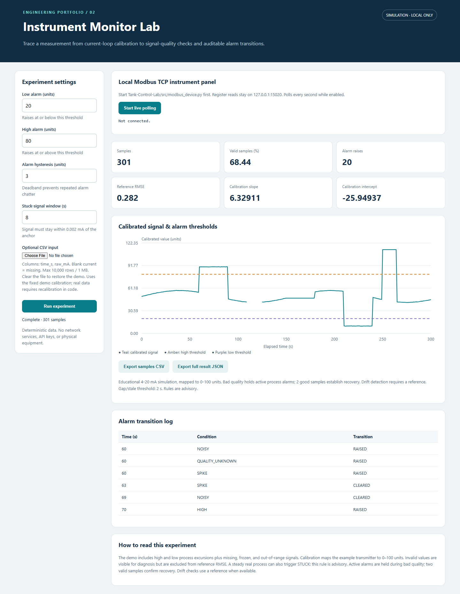
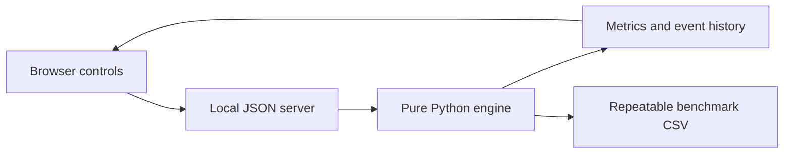
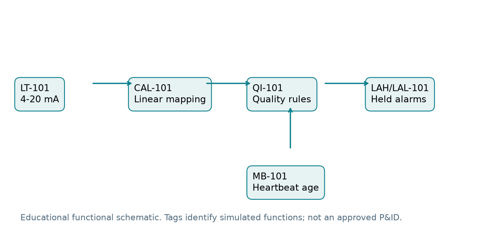

# Instrument Monitor Lab

Calibration, signal-quality checks, and traceable alarm behavior from synthetic current-loop data.

**Educational engineering simulation.** The study records successful and difficult cases transparently. No physical plant or safety-system validation is claimed.



## Run locally

Python 3.10+; standard library only. No pip install or credentials are required for the application.

```powershell
python src/server.py
python -m unittest discover -s tests -v
python benchmark.py
python evaluate.py
```

Run each command separately from this folder. On Windows, double-click `Launch.cmd` for the dashboard. Ctrl+C stops it. Default port: 8766; choose `--port 8800` if busy. `--no-browser` disables automatic opening.

## Architecture





## Study and measured results

Ten scenarios across five seeds (50 runs). Tests cover bad-quality alarm retention, two-sample recovery, stale data and repeated dropouts. Reference-assisted drift, spikes and noise are evaluated with precision, recall, delay and false-positive samples; healthy steps expose diagnostic ambiguity.

Every run is available in `examples/`. Read `docs/engineering-study.md` and `Instrument-Monitor-Lab-Explanation.pdf` for definitions, tables and trade-offs. `docs/datasheet.md` records tags and engineering units. `docs/demo.mp4` is a one-minute captioned browser recording.

## Local Modbus integration

In a terminal inside **Tank-Control-Lab**:

```powershell
python src/modbus_device.py
```

Start the **Instrument-Monitor-Lab** dashboard and select **Start live polling**. FC03 reads six scaled holding registers from 127.0.0.1:15020, unit 1. To demonstrate stale communication, restart the device using `python src/modbus_device.py --freeze-after 6`.

The device simulates level, inlet flow, sensor current, actuator command, heartbeat and quality. No PLC or external network is needed. Do not expose either server to a network.

## Verification and boundaries

22 automated tests passed locally with Python 3.14.7. Browser checks include desktop/mobile layout, controls, exports and live stale-data display. The GitHub Actions workflow is supplied for pushes and pull requests; it has not been executed on GitHub. Other matrix Python versions are configured, not claimed as locally verified.

Healthy steps may trigger spike/noise rules. Frozen and steady healthy signals can look alike. Drift checks require independent reference data; CSV and live tags do not provide it. Live history is capped at 10,000 polls and reprocessed each poll.

No public repository was created or modified. Study and reproduce the experiments before discussing them as portfolio work; implementation was developed with AI assistance.

## Documentation maintenance

`docs/report-source.json` is the editable PDF source. `python docs/build_report.py` rebuilds the saved report with ReportLab (`python -m pip install -r docs/requirements-report.txt`). This does not update plots or claims automatically after a model change: rerun benchmarks and revise the report source. Application and tests have no third-party dependencies.

References: [Modbus specification](https://www.modbus.org/file/secure/modbusprotocolspecification.pdf), [GitHub Python CI documentation](https://docs.github.com/en/actions/tutorials/build-and-test-code/python).
