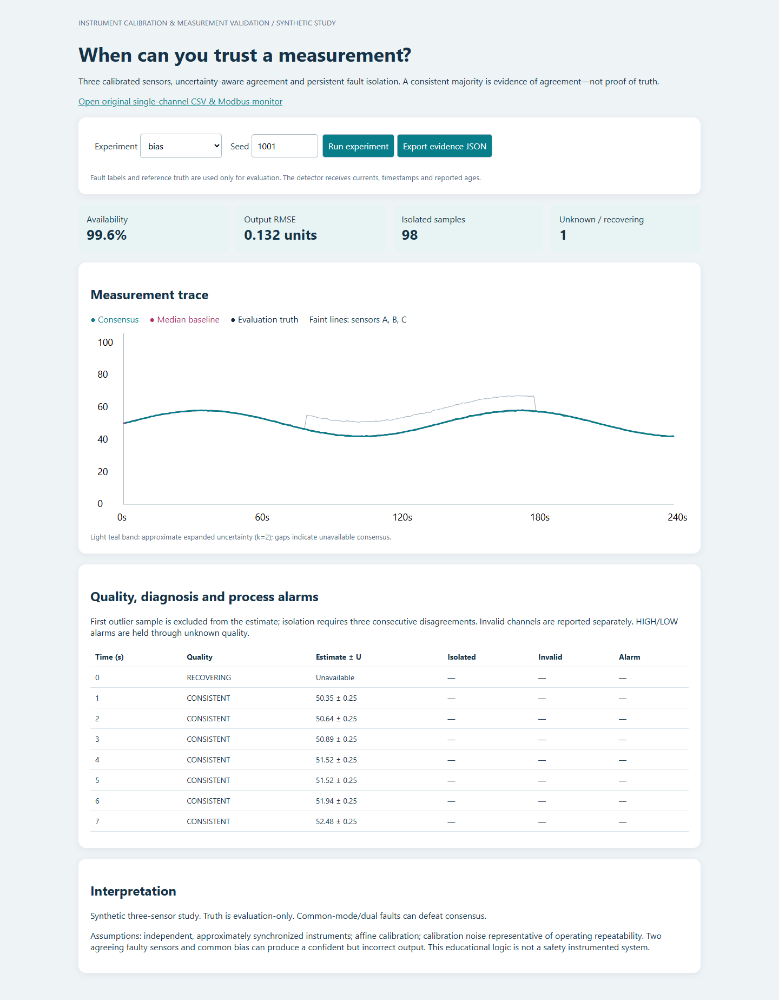
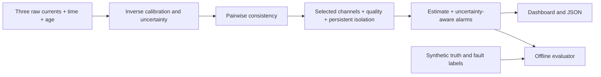

# Instrument Calibration & Measurement Validation

**Engineering question:** when three instruments disagree, which measurement can be used, with what uncertainty, and when should the system refuse to provide an estimate?

This local Python project calibrates three simulated transmitters, evaluates pairwise agreement using propagated uncertainty, excludes a disagreeing channel and identifies persistent disagreement. It preserves process alarms through unknown measurement quality. An independent test bench quantifies accuracy, availability, diagnostic delay and failure cases. The original single-channel monitor, CSV input and local Modbus demonstration are retained.

All validation is synthetic. No hardware commissioning, industrial validation or safety certification is claimed.

## Start

Requires Python 3.10+. No packages are required for the app, tests or experiments.

```powershell
python src/server.py
```

Or double-click `Launch.cmd`. Open **http://127.0.0.1:8766/study.html** for the upgraded study. The root page links to it and retains the original CSV and Modbus monitor. Use `--port 8767` if the default port is occupied. The server binds to loopback only.

Try **bias → drift → common_mode → dual_fault → high_noise**. The first two show useful diagnosis; the others expose assumptions. Export JSON to inspect every input, estimate, uncertainty, diagnosis and alarm state. Truth is shown for evaluation only and never enters the validator.



## Architecture



- `src/calibration.py`: forward least-squares fit, inverse measurement, repeatability and coefficient covariance.
- `src/validation.py`: three-channel agreement, invalidity, persistence, recovery and held alarms.
- `src/study.py`: deterministic scenarios, comparator integration and scoring. The detector never receives truth or fault labels.
- `study_benchmark.py`: fixed-seed runner and raw evidence export.
- `src/server.py`, `src/study.html`: local UI; POST `/api/study` accepts scenario and seed.
- `src/engine.py`, `src/live.py`, `src/modbus_wire.py`: preserved single-channel implementation; POST `/api/run` retains its contract.

## Reproduce the evidence

```powershell
python -m unittest discover -s tests -v
python study_benchmark.py
python benchmark.py
```

The study covers **16 scenarios × 20 withheld seeds = 320 runs**. Calibration validation uses **3,000 independent readings**. Inspect `examples/study/summary.csv`, `summary.json`, `run-scores.json`, `calibration-readings.json` and each representative `*-1001.json` trace. Seeds, thresholds and scoring definitions are saved alongside results.

In 20 single-sensor bias runs, consensus common-sample RMSE was **0.12897 units** versus **0.15990** for a three-channel median, a **19.3% reduction**. It diagnosed **20/20 bias events**, with a mean **2-second** delay. Calibration validation RMSE was **0.192–0.217 units**. These results apply to the defined synthetic conditions.

Counterexamples are retained: common-mode bias is undetected; two agreeing faulty sensors can cause healthy-channel isolation; elevated noise lowers availability and uncertainty coverage. Under elevated noise, consensus common-sample RMSE is worse than the median baseline. Read the full report for all results.

## Documentation

- [Decision record written before implementation](docs/decision-record.md)
- [Full engineering report](docs/engineering-study.md)
- [Printable report](Instrument-Monitor-Lab-Explanation.pdf)
- [Verified resume bullets](docs/resume-bullets.md)
- [Verification record](docs/verification.md)
- [Beginner walkthrough for both projects](docs/Both-Projects-Explained-From-Software-to-Instrumentation.md)
- [New three-channel walkthrough](docs/three-channel-walkthrough.md)

To refresh figures and numerical text after regenerating evidence:

```powershell
python -m pip install matplotlib reportlab
python docs/refresh_study_docs.py
python docs/build_report.py
```

Reporting dependencies are separate from the application. The PDF renderer reads saved report source: refresh documentation first after changing experiments. GitHub Actions is configured for tests and both benchmarks on Python 3.10, 3.12 and 3.14; no remote CI run is claimed.

## Original CSV and Modbus demonstration

At `/`, upload CSV with `time_s,raw_mA`, blank currents for missing data, nonnegative strictly increasing timestamps, maximum 10,000 rows / 1 MB. It uses the original fixed calibration and temporal rules, not the new three-instrument validator.

For the original local live demonstration, start `python src/modbus_device.py` in the companion Tank-Control-Lab project, then select Start live polling. Reads use `127.0.0.1:15020`, FC03, registers 0–5: level, inlet flow, current, actuator, heartbeat and quality. These are six process tags, not three independent sensors. Existing `docs/demo.mp4` and earlier screenshots demonstrate this original mode.

## Boundaries

The new study assumes affine calibration, representative repeatability, independent sensors and predominantly single-channel faults. It does not synchronize devices, estimate common-cause probability, prove physical reference accuracy or detect every frozen sensor on a steady process. k=2 bands are approximate. A consistent majority can be wrong. Alarm hold and uncertainty gates are educational logic, not industrial safety actions.

Hardware, ML, cloud deployment, additional protocols and model observers are excluded. The contribution is a testable measurement-validation argument with quantified trade-offs.
