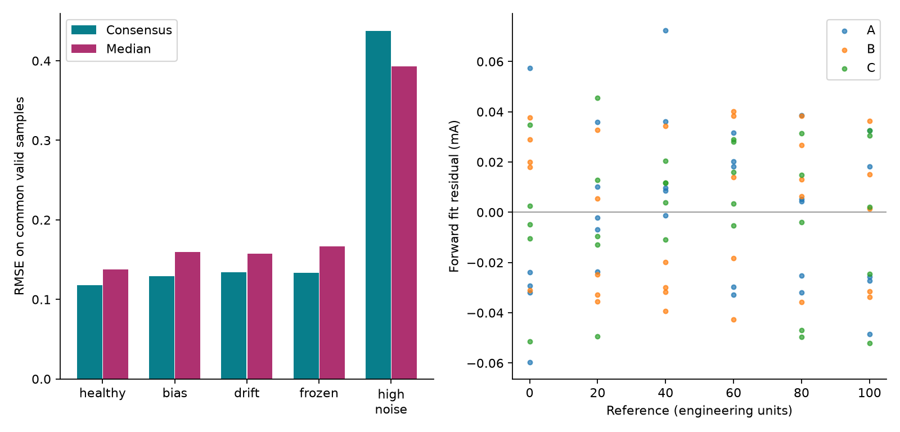
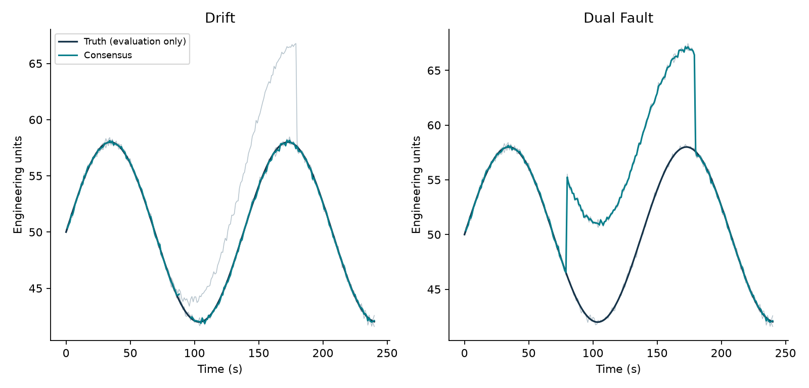

# Instrument Measurement Validation — engineering report

Updated 22 October 2026. All results are simulated.

## Problem and original limitations

The original monitor converts current to engineering units, checks temporal signal quality, and manages process alarms. Its architecture, missing-data handling, hysteresis and tests remain useful. Its perfectly collinear calibration points, however, do not demonstrate calibration error characterisation. A single signal cannot reliably distinguish genuine process drift from sensor drift.

The original 50-run benchmark remains reproducible with benchmark.py. It records 100 false-positive samples on healthy steps, 9.1% sample precision for spikes, and no detected unreferenced drift events. These results motivated a change in information available to the detector, rather than adding more dashboard features.

New problem: can three independently calibrated instruments provide a defensible measurement when one instrument becomes unreliable? The output includes uncertainty, quality, persistent isolation and process-alarm state. All evidence is synthetic; there is no hardware or industrial validation.

## Decision and alternatives

| Approach | Value / limitation | Decision |
| --- | --- | --- |
| Calibration analytics only | Quantifies error; does not resolve process/fault ambiguity | Supporting layer |
| Temporal thresholds or CUSUM | Needs a trustworthy baseline or process model | Legacy comparator retained |
| Tank observer | Useful but requires validated flows and model uncertainty | Deferred |
| Three independent instruments | Makes single-channel disagreement observable | Selected |
| ML, cloud, more protocols | Does not fix missing diagnostic information | Excluded |

The alternatives and selected design were recorded in decision-record.md before implementation. Thresholds were chosen before the held-out evaluation and were not retuned after inspecting results. Later observations about common-mode failures and elevated noise are validation findings, not claims that these choices were experimentally optimal.

Added redundancy is a real assumption and cost. The single-channel comparison cannot establish an algorithm-only improvement. The three-channel median baseline receives the same additional currents and is the main measurement-quality comparator.

## Architecture and input contract

Raw currents|A / B / C → Inverse|calibration → Pairwise|agreement → Quality and|isolation → Estimate and|alarms

calibration.py fits and inverts each transmitter. validation.py receives only timestamp, three currents, three reported ages and calibration models. study.py generates synthetic inputs, runs the detector, then attaches truth and fault labels for scoring. The detector never receives truth or labels. study_benchmark.py writes per-run scores and scenario aggregates.

The existing engine.py, CSV upload, event log and one-channel Modbus client remain available at /. The new study is at /study.html and POST /api/study. The six existing Modbus registers do not represent three independent instruments; they are not used as evidence for redundancy.

Timestamps must be finite, nonnegative and strictly increasing. Inputs require exactly three currents and ages. Missing, nonfinite, out-of-range, negative-age or stale channels are unavailable. A timestamp gap over 2 seconds invalidates the current batch; recovery requires two consecutive usable batches. Known age greater than 2 seconds is stale. Hidden skew is not automatically corrected.

## Calibration mathematics and uncertainty

For each channel, fit I = a + b*x + epsilon using ordinary least squares, where I is current in mA and x is the reference in 0-100 engineering units. Six levels with five repeats produce 30 observations per channel. Calibration seeds are 101, 102 and 103. Noise standard deviation is 0.032 mA; transmitter (a,b) pairs are (4.10,0.158), (4.04,0.159), (3.98,0.160).

The measurement is x_hat = (I-a)/b. With residual variance s^2 = SSE/(n-2), Sxx = sum((x-x_bar)^2), the independent inverse variance is [s^2 + s^2*(1/n + (x_hat-x_bar)^2/Sxx)]/b^2. This is first-order propagation of repeatability and fit-coefficient covariance. It assumes affine response, independent approximately Gaussian current errors, negligible slope uncertainty beyond first order, and accurate reference levels for the fit.

A shared reference standard uncertainty of 0.05 units is an explicit assumed budget allowance. It is not estimated from physical calibration equipment. Consensus over m selected channels uses U = 2*sqrt(sum(u_independent^2)/m^2 + u_reference^2). The shared term does not shrink with averaging and cancels in pairwise differences. Equal weighting avoids pretending the small repeatability estimates justify precise reliability weights.

Electrical acceptance is 3.8-20.5 mA, followed by a calibrated-span gate with a 1-unit endpoint allowance for noisy readings. This is an educational choice, not a claimed industrial standard. Zero residual variance is rejected because it cannot support this empirical noise budget. k=2 bands are approximate, not exact 95% prediction intervals.

Methods reference: <link href="https://www.itl.nist.gov/div898/handbook/mpc/section3/mpc366.htm" color="#087e8b">NIST inverse calibration</link> and <link href="https://www.itl.nist.gov/div898/handbook/pmd/section5/pmd521.htm" color="#087e8b">NIST calibration uncertainty</link>.

## Agreement, isolation and alarm decisions

Channels i and j agree when |xi-xj| is no larger than max(0.5 units, 4*sqrt(ui^2+uj^2)), using independent variances. The 4-standard-uncertainty threshold deliberately favours low nuisance isolation; it does not imply a system-wide Gaussian false-alarm probability after repeated testing. The floor prevents implausibly tight agreement at very low estimated noise.

| Evidence | Action |
| --- | --- |
| All three pairs agree | Use arithmetic mean of three |
| Exactly one pair agrees | Use that pair; third available channel is suspect |
| Two agreeing edges, or no pair | Ambiguous; output UNKNOWN |
| Only one available channel | Insufficient redundancy; UNKNOWN |
| Same suspect for 3 consecutive samples | Report isolated channel |
| Agreement recovers | Reset isolation immediately; no repair acknowledgement model |

Suspect channels are excluded from the estimate immediately; persistent isolation is a separate decision. One-sample spikes therefore can be rejected without being classified as persistent faults. An UNKNOWN interval restarts the two-sample quality recovery. With a usable pair, quality is DEGRADED; all three agreeing gives CONSISTENT. Neither word proves health.

HIGH raises when the lower uncertainty bound reaches 80 and clears only when the upper bound reaches 77 or less. LOW raises when the upper bound reaches 20 or less and clears when the lower bound reaches 23. Ambiguous bounds and unknown quality hold previous alarm state. This delays declarations until measurement evidence supports them; it is educational logic, not a fail-safe action or a safety-system design.

## Reproducible experiment design

320 runs cover 16 scenarios with 20 withheld seeds (1001-1020), each lasting 240 seconds with nominal 1-second samples. Calibration seeds are separate. Seeds 7 and 11 are reserved for development and are not included in the published study. Bias/drift magnitude varies uniformly from 5 to 10 units; the affected channel rotates by seed modulo 3. Faults generally occur from 80 to 179 seconds inclusive.

Scenarios: healthy sinusoid, common step, stable plateau, drift, bias, isolated spikes, noisy sensor, frozen sensor, intermittent dropout, irregular sampling, stale channel, all channels missing, common-mode bias, two agreeing faulty sensors, hidden 8-second skew, and increased noise on all sensors. Complete formulas are in study.generate; representative raw currents, ages and labelled traces are saved for seed 1001.

Baseline 1 applies the original temporal logic to calibrated channel A without a truth reference. Inputs are converted back to its nominal current convention so differences are not simply calibration offsets. Its information is less than the new detector; faults rotate across channels, so some faults do not affect A. Baseline 2 is the median of electrically/calibration-valid readings without age, agreement or recovery gating.

Independent calibration validation uses 10 withheld levels (5,15,...95), 100 readings per level and seeds 9001-9003: 3,000 samples. This is validation under the assumed linear/noise model, not evidence of real sensor linearity. The shared reference allowance is included in intervals but a shared physical reference bias is not randomly injected.

## Metrics and fair comparisons

Sample diagnosis is a union of explicit invalidity and persistent isolation, matched to channel-specific injection labels. Precision = TP/(TP+FP), recall = TP/(TP+FN). A fault event is a contiguous labelled interval for one channel; detection must occur inside that interval. Delay is elapsed time to first diagnosis and is reported only for detected events. Missed events are shown explicitly.

false_episodes counts contiguous false diagnosis episodes, including quality invalidations. false_isolation_episodes counts only persistent isolation of unlabelled channels. In irregular sampling, no sensor fault is labelled: the 360 conservative gap invalidations count as false diagnoses, but there are zero false sensor-isolation episodes. This distinction avoids calling communication caution a sensor fault.

Output RMSE is measured on accepted samples and must be read with availability. Median and consensus are also compared on identical common valid timestamps within each run. Tables report the mean of per-run RMSE, not a pooled RMSE; availability and uncertainty coverage are pooled sample fractions. Coverage counts truth within the reported k=2 band, conditional on an available output.

Do not collapse all scenarios into one accuracy number. Multi-fault and noise-mismatch cases violate key assumptions and expose failure envelopes. Precision/recall are undefined when their denominators are zero and are reported N/A. Three-sample persistence at 1 Hz creates a nominal 2-second bias diagnosis delay; this is not a universal real-time guarantee.

## Calibration validation results

| Channel | Validation samples | RMSE (units) | Max error | k=2 coverage |
| --- | --- | --- | --- | --- |
| A | 1000 | 0.217 | 0.820 | 95.6% |
| B | 1000 | 0.210 | 0.786 | 94.9% |
| C | 1000 | 0.192 | 0.600 | 94.7% |

Residuals reveal the scatter that the original exactly collinear calibration omitted. The nominal validation coverages are near 95%, but small calibration samples and unmodelled nonlinearity/reference bias limit that interpretation. The high-noise experiment shows that a nominal uncertainty budget cannot be trusted after operating noise changes.

## Nominal and single-fault results

| Scenario | Events hit / total | Delay s | Recall | Available | Coverage |
| --- | --- | --- | --- | --- | --- |
| healthy | 0/0 | N/A | N/A | 99.5% | 96.3% |
| step | 0/0 | N/A | N/A | 99.5% | 96.3% |
| plateau | 0/0 | N/A | N/A | 99.5% | 96.2% |
| drift | 20/20 | 21.150 | 78.0% | 97.1% | 95.1% |
| bias | 20/20 | 2.000 | 97.9% | 99.5% | 96.3% |
| spikes | 0/60 | N/A | 0.0% | 99.5% | 96.3% |
| noise | 20/20 | 3.100 | 61.4% | 97.3% | 94.2% |
| frozen | 20/20 | 5.300 | 84.9% | 97.8% | 95.4% |
| dropout | 100/100 | 0.000 | 100.0% | 99.5% | 96.2% |
| stale | 20/20 | 0.000 | 100.0% | 99.5% | 96.3% |

Full precision, false diagnoses, false isolations, per-run scores, common-sample errors and baseline availability are saved in examples/study/summary.csv and run-scores.json. Events with no detection have N/A delay. Spikes are excluded from consensus immediately but deliberately do not satisfy persistent isolation; zero event recall must not be described as complete spike diagnosis.

## Failure-envelope results

| Scenario | Events hit / total | Delay s | Recall | Available | Coverage |
| --- | --- | --- | --- | --- | --- |
| irregular | 0/0 | N/A | N/A | 94.0% | 96.0% |
| all missing | 60/60 | 0.000 | 100.0% | 57.6% | 96.5% |
| common mode | 0/60 | N/A | 0.0% | 99.5% | 56.4% |
| dual fault | 0/40 | N/A | 0.0% | 99.5% | 56.3% |
| misaligned | 20/20 | 2.000 | 60.5% | 94.6% | 93.2% |
| high noise | 0/0 | N/A | N/A | 80.8% | 75.9% |

Full precision, false diagnoses, false isolations, per-run scores, common-sample errors and baseline availability are saved in examples/study/summary.csv and run-scores.json. Events with no detection have N/A delay. Spikes are excluded from consensus immediately but deliberately do not satisfy persistent isolation; zero event recall must not be described as complete spike diagnosis.

## Measured improvement and trade-offs

For bias, all 20/20 injected events were diagnosed with a mean delay of 2.0 seconds. Common-sample RMSE fell from 0.1599 for the median to 0.1290 units for consensus: a 19.3% reduction. Availability was 99.5%; sample recall was 97.9% because of persistence and occasional disagreement ambiguity.

Across healthy, step and plateau experiments there were zero false sensor-isolation episodes in 60 runs. The healthy-step comparison recorded 400 quality-flagged legacy samples versus zero false isolations in the new method. These are different diagnostic outputs, not interchangeable accuracy rates. Consensus availability remained 99.5%, not 100%, because ambiguous agreement and startup recovery can suppress output.

Drift detection took 21.15 seconds on average and had 78.05% sample recall: small drift initially remains indistinguishable from noise. Frozen detection averaged 5.3 seconds and depends on the process moving away from the frozen value. A truly stationary process cannot identify a perfectly agreeing frozen instrument.

## Limits, exclusions and engineering judgement

Common-mode bias produced zero diagnosed events and about 4.65 units RMSE while consensus remained available. Two faulty sensors agreeing with each other caused the healthy channel to be isolated in 20 runs. Redundancy needs independence, physical diversity and common-cause assessment; counting sensors alone does not provide reliability assurance.

With elevated noise on all channels, availability fell to 80.8%, k=2 coverage to 75.9%, and common-sample RMSE worsened to 0.438 versus the median baseline at 0.393 units. A recalibrated noise budget or explicit adaptive uncertainty model is future work; retuning after seeing these results would require fresh validation seeds.

Hidden timestamp skew can resemble a sensor fault. The project checks reported age but does not synchronize devices or estimate network latency. Calibration linearity, physical reference uncertainty, sensor independence, error distributions, numerical thresholds and alarm setpoints are assumptions. No physical units beyond a generic engineering scale are claimed.

Excluded: ML, cloud deployment, new protocols, hardware procurement, a process observer, automated sensor repair, SIL/IEC compliance claims, safety actuation and physical commissioning. The existing Modbus interface remains an educational loopback demonstration.

## Reproduce, inspect and explain

Application: python src/server.py, then open /study.html. Choose bias, drift, common_mode and dual_fault in that order. Export JSON and inspect isolated, selected, invalid, quality, expanded_u, high and low for each timestamp. Then compare high_noise against healthy.

Checks: python -m unittest discover -s tests -v. Evidence: python study_benchmark.py. Legacy comparison: python benchmark.py. Refresh figures and numerical report source: python docs/refresh_study_docs.py (matplotlib required). Rebuild PDF: python docs/build_report.py (ReportLab required). The application, automated tests and benchmarks use the standard library only.

A software-focused explanation: calibration is a noisy coordinate transform with an error budget; the validator is a state machine constrained by measurement evidence; the test bench is a fault-injection harness with labels kept separate from production inputs. The engineering contribution is choosing what the system can infer and testing when those inferences fail.

Interview exercise: explain why a median already handles one large outlier; why consensus improves bias error yet can reduce availability; why uncertainty does not average down for shared reference error; and why two agreeing bad sensors can defeat the algorithm. Verification records and resume bullets are saved separately in docs.
